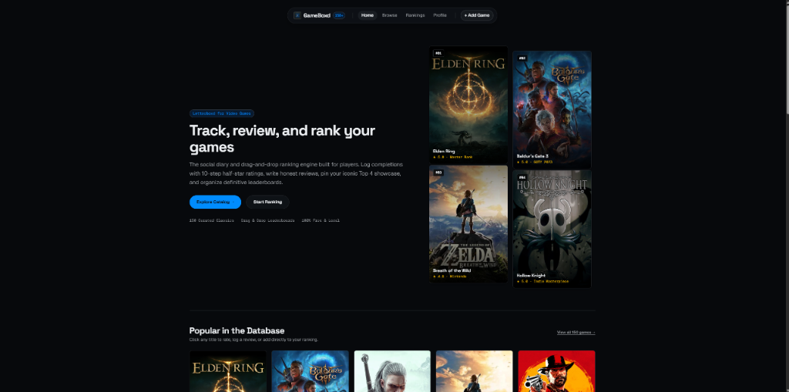
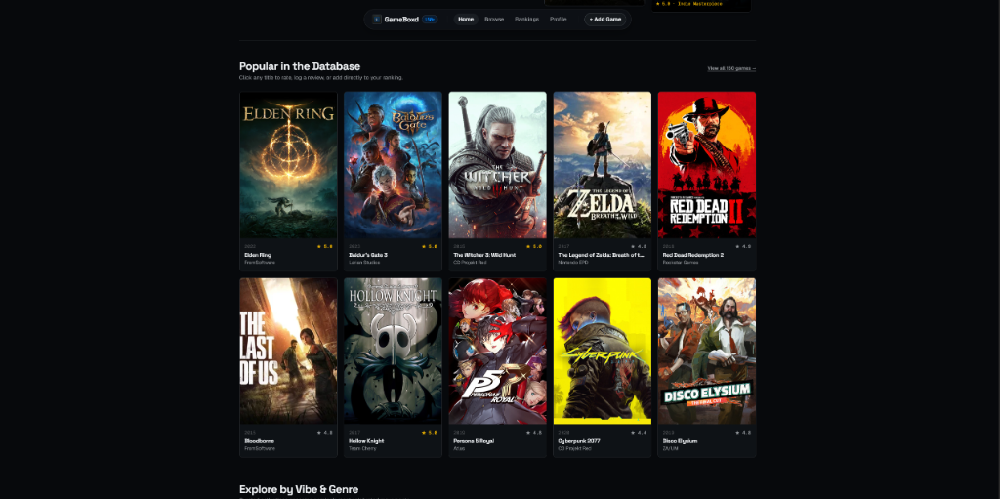
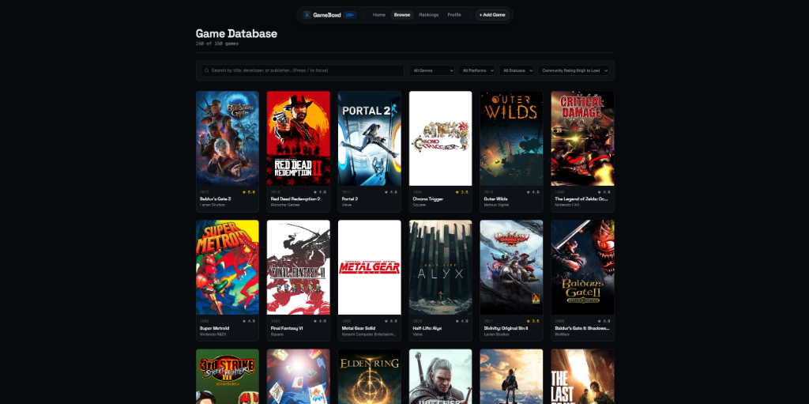
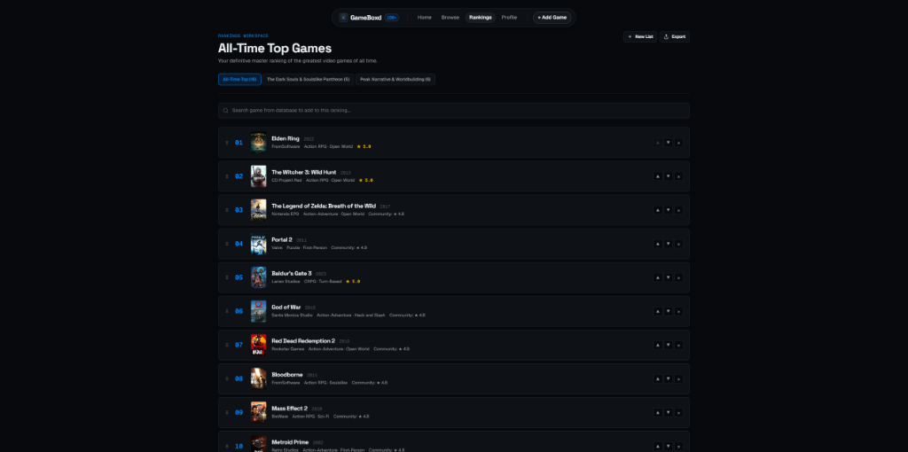
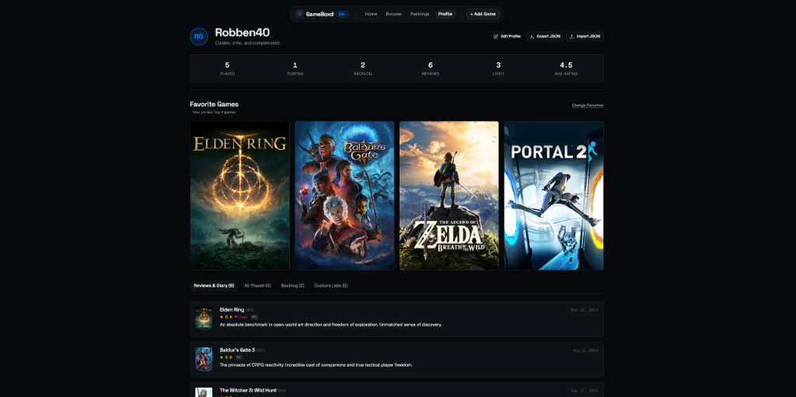
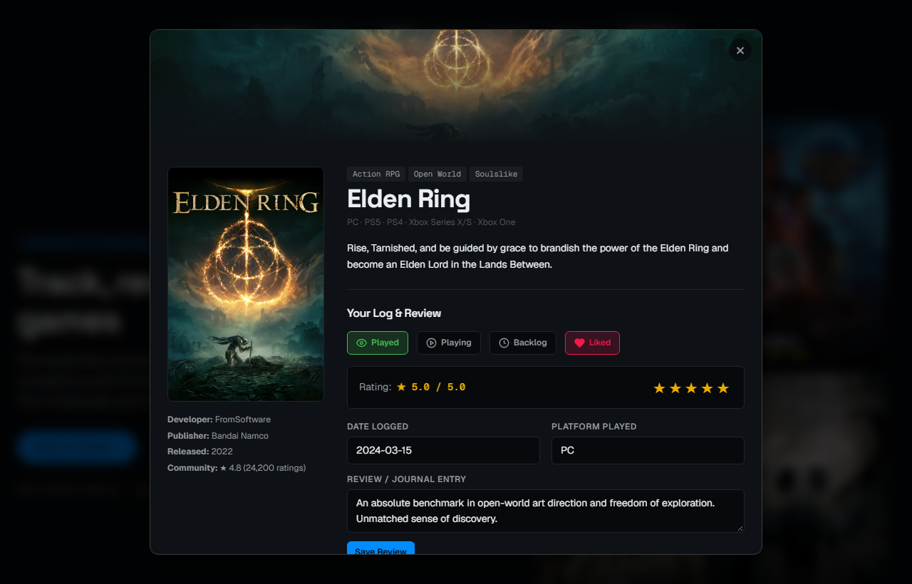

# GameBoxd — Letterboxd for Video Games

> "Track, review, and rank your gaming life."

A lightweight, client-side Single Page Application (SPA) designed as a love letter to video games and the Letterboxd user experience. Built from scratch with modern vanilla web standards, zero third-party framework dependencies, and a clean modern-minimal dark aesthetic.

---

## Interface Preview

<div align="center">

### 1. Landing Page & Hero Mosaic
*Modern-minimal hero introducing GameBoxd with floating pill navigation (`N5`) and featured GOTY mosaic cards.*



<br/>

### 2. Popular in the Database Spotlight
*Interactive spotlight grid showcasing curated classics with live ratings, developer tags, and quick actions.*



<br/>

### 3. Game Catalog & Faceted Search
*High-density inventory of 150+ games with instant title/developer search, keyboard shortcuts (`/`), genre filters, and multi-metric sorting.*



<br/>

### 4. Drag-and-Drop Rankings Workspace
*Reorder your personal All-Time Top leaderboard or themed lists with native HTML5 drag-and-drop, step buttons, and 1-click Markdown export.*



<br/>

### 5. Player Profile & Pinned Top 4
*Gamer telemetry stats (Played, Backlog, Reviews, Likes, Avg Rating), iconic pinned Top 4 favorites, and chronological review journal.*



<br/>

### 6. Half-Star Review & Logging Modal
*Log completion dates, platforms, written critiques, and 0.5 to 5.0 star ratings with live hover preview feedback.*



</div>

---

## About the Project

GameBoxd started as a side project built during my free time to scratch a personal itch.

As an avid gamer and a longtime Letterboxd user, I wanted a gaming tracker that offered the same snappy, tactile, and clutter-free experience. Existing platforms often felt weighed down by ads, slow load times, or lacked intuitive ways to organize and visually rank personal leaderboards.

What began as an experiment evolved into a fully featured web application with a curated library of **150+ iconic titles**, custom **drag-and-drop leaderboards**, **10-step half-star ratings**, a personalized **player profile with pinned Top 4 favorites**, and **100% local-first storage**.

---

## Key Features

### 1. Game Diary & Logging
- **10-Step Half-Star Ratings**: Rate any game from 0.5 to 5.0 stars with interactive hover previews and responsive star fills.
- **Play Status Tracking**: Toggle between `Played`, `Currently Playing`, and `Backlog / Want to Play`.
- **Favorites & Likes**: Heart button to highlight standout games.
- **Review Diary**: Write timestamped game critiques, log completion dates, and specify the platform played on (PC, PlayStation, Xbox, Switch, etc.).

### 2. Drag-and-Drop Rankings Workspace
- **Personal Master Leaderboard**: Visually drag and drop your all-time favorite games to arrange your definitive ranking.
- **Themed Custom Lists**: Create and manage multiple custom lists (e.g., *"The Dark Souls Pantheon"*, *"Peak Narrative & Worldbuilding"*, *"Indie Classics"*).
- **Inline Catalog Search & Insertion**: Search any game from the library and drop it directly into your list at any position.
- **Touch & Accessibility Controls**: Step buttons (Move Up / Down) and keyboard navigation for full mobile and accessibility support.
- **Markdown / Text Export**: One-click copy formatted leaderboards to clipboard for sharing on Discord, Reddit, or social channels.

### 3. Player Profile & Top 4 Showcase
- **Pinned Top 4 Favorites**: Select and feature your 4 defining games on your profile header, inspired by Letterboxd's signature showcase.
- **Real-Time Gaming Telemetry**: Live metric counters for *Total Games Played*, *Currently Playing*, *Backlog Queue*, *Reviews Written*, *Favorites*, and *Personal Average Rating*.
- **Activity & Diary Feed**: A chronological timeline displaying your recent reviews, playthrough dates, and star ratings.
- **Customizable Identity**: Editable display name, bio, and avatar.

### 4. 150+ Curated Games Database & In-App Expansion
- **Broad Historical & Genre Coverage**: Pre-seeded with 150 classic and modern masterpieces (from SNES and PC essentials like *Chrono Trigger* and *Half-Life 2* to modern GOTY powerhouses like *Elden Ring*, *Baldur's Gate 3*, and *Hollow Knight*).
- **Rich Game Metadata**: Cover artwork, developers, release years, platform tags, community ratings, and synopses.
- **In-App Add Game Engine**: Add new titles on the fly via an intuitive modal form. Custom games persist locally and integrate seamlessly into catalog search and rankings.

### 5. Instant Search & Faceted Filtering
- **Live Instant Search**: Filter through games in real-time by title or developer with zero latency (with `/` keyboard shortcut).
- **Multi-Category Filters**: Filter by **Genre** (*Action RPG*, *CRPG*, *Metroidvania*, *Survival Horror*, *Indie*, *Roguelike*, etc.), **Platform**, and **Play Status**.
- **Flexible Sorting**: Sort instantly by Community Rating, Release Year (Oldest/Newest), or Alphabetically.

### 6. Local-First & Privacy-Focused Architecture
- All user ratings, reviews, lists, and custom games persist automatically in browser `localStorage`.
- No forced account creation, no telemetry tracking, and no external database dependencies.
- **JSON Backup & Restore**: One-click export and import of your entire GameBoxd library and history.

---

## Tech Stack & Architecture

This project was built entirely with **vanilla web standards** to emphasize solid software fundamentals and direct browser API mastery:

| Layer | Technology | Details |
| :--- | :--- | :--- |
| **Markup** | HTML5 | Semantic landmarks (`<main>`, `<section>`, `<nav>`, `<dialog>`), full ARIA tablists, accessible form controls. |
| **Styling** | Modern CSS3 | CSS Custom Properties (Design Tokens), OKLCH color spaces, CSS Grid, Flexbox, Container Queries, zero CSS frameworks. |
| **Logic** | Vanilla JavaScript (ES6+) | Native ES Modules, async/await, modern DOM APIs, HTML5 Drag & Drop API, Web Storage API. |
| **State Pattern** | Custom Pub/Sub Store | Reactive single-source-of-truth state container (`js/store.js`) with subscriber event dispatching. |
| **Routing** | Client-Side SPA Hash Router | URL hash routing (`#home`, `#browse`, `#rankings`, `#profile`) with deep query linking support. |
| **Design System** | Modern-Minimal Dark | Inspired by Linear and Steam; Cobalt Dark Utilitarian palette (`OKLCH` slate paper and electric cobalt accents); N5 floating pill navigation with glassmorphism backdrop filter. |
| **Typography** | Google Fonts | `Space Grotesk` (Display & Ranks), `Geist` (Body & UI), `Geist Mono` (Badges, dates & metrics). |


---

## Quick Start

You can run this project in seconds without installing any packages or dependencies:

Navigate to the project directory and double-click `index.html`, or open it in any modern browser (Chrome, Edge, Firefox, Safari, Brave).

---

## Project Structure

```text
GameBoxd/
├── index.html              # Main Single Page Application shell and views
├── assets/
│   ├── logo.jpg            # Application brand logo
│   └── screenshots/        # High-resolution application screenshots
│       ├── 01-landing-hero.png
│       ├── 02-popular-spotlight.png
│       ├── 03-game-database.png
│       ├── 04-rankings-workspace.png
│       ├── 05-profile-and-diary.png
│       └── 06-review-modal.png
├── css/
│   ├── tokens.css          # Design system tokens (OKLCH colors, spacing, typography)
│   └── styles.css          # App-wide layouts, cards, modals, drag-and-drop styles
├── js/
│   ├── app.js              # Application bootstrapper, SPA hash router, keyboard shortcuts
│   ├── store.js            # State store, localStorage persistence, pub/sub reactive core
│   ├── catalog.js          # Browse view: search, multi-filter, sort, card grid rendering
│   ├── ranking.js          # Drag-and-drop engine, custom lists, markdown exporter
│   ├── profile.js          # Top 4 showcase, stats calculations, diary activity feed
│   └── modal.js            # Reusable dialog controller (game reviews, details, add game)
├── data/
│   ├── games.json          # Curated database of 150+ games with metadata
│   └── games-data.js       # Global fallback dataset for local file:// protocol access
└── README.md               # Project documentation
```


---

*GameBoxd is an independent, non-commercial fan project inspired by Letterboxd. All game titles, covers, and trademarks belong to their respective publishers and developers.*
